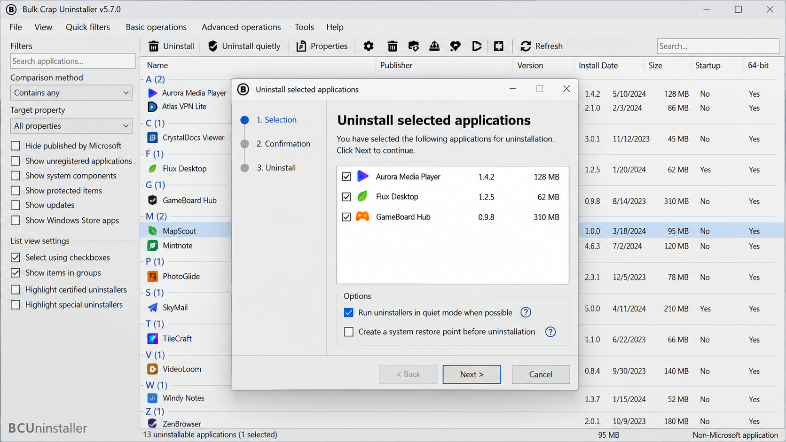
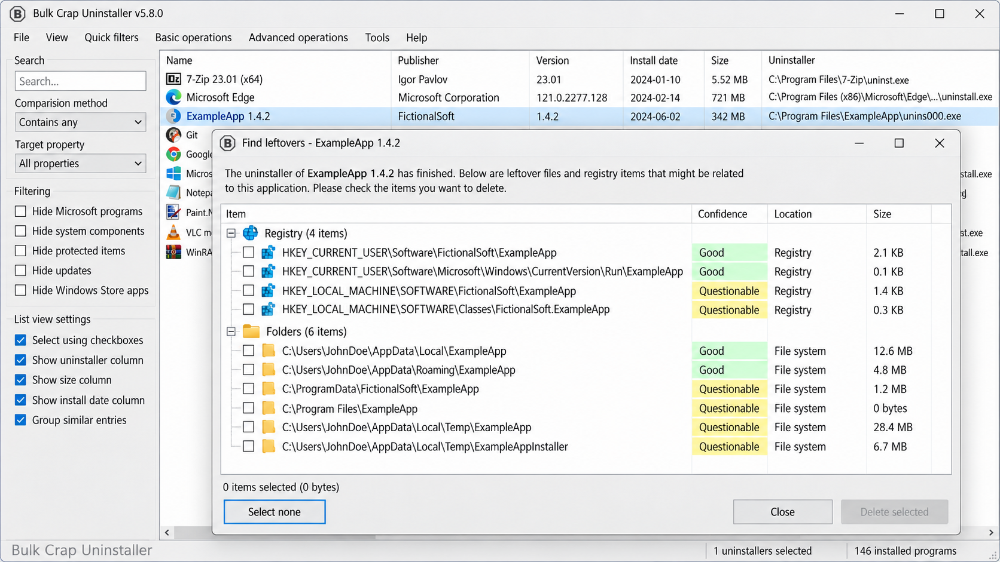
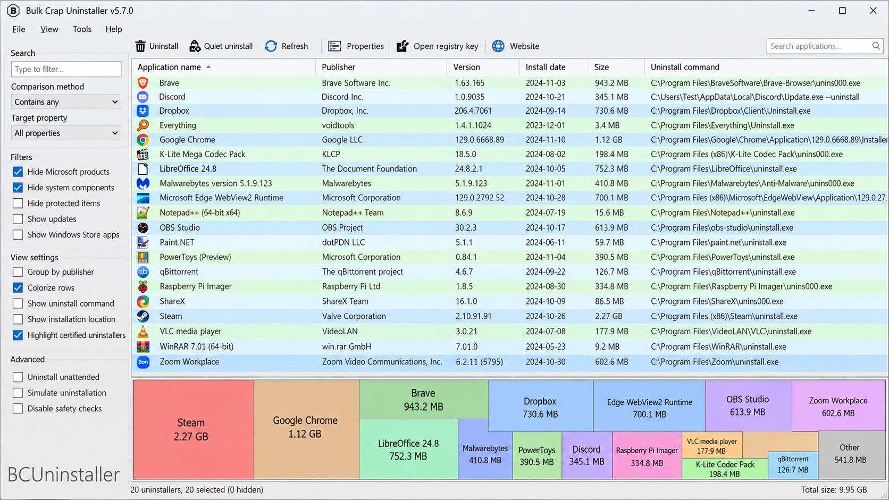

# Bulk Crap Uninstaller - Batch Windows Software Removal

Bulk Crap Uninstaller, also known as BCUninstaller, is a free and open-source Windows uninstaller maintained by Bulk Uninstaller. It removes multiple applications in one queue, detects orphaned entries, runs known uninstall commands, and scans for files, folders, and registry entries left behind after removal.

Bulk Crap Uninstaller supports traditional desktop programs, Microsoft Store packages, Steam games, and several installer systems, including MSI, NSIS, and Inno Setup. Bulk Uninstaller designed the project for administrators and power users, but its guided interface also makes batch removal accessible to regular Windows users.

> [!WARNING]
> Uninstalling software and deleting leftovers can permanently remove data. Review every selected application and cleanup result before confirming an operation.

## Download

### What are the different variants?

| Variant | Description |
|---|---|
| Setup | Installs Bulk Crap Uninstaller as a normal Windows application. |
| Portable | Runs without a conventional installation and keeps the utility easy to move between systems. |
| Runtime-dependent | Provides a smaller package for systems that already have the required .NET desktop runtime. |

The Bulk Crap Uninstaller portable edition is useful for maintenance drives and temporary support sessions. The standard installer is defined in [BcuSetup.iss](BcuSetup.iss).

## System requirements

| Version | Supported environment | Runtime |
|---|---|---|
| Current source | Windows 10 or Windows 11 | .NET 8 desktop runtime |
| Portable release | Windows 10 or Windows 11 | Runtime included |
| Source build | Visual Studio 2022 on Windows | Compatible .NET SDK and desktop workload |

Bulk Crap Uninstaller Windows 11 support covers desktop software, Microsoft Store applications, and Steam installations. Bulk Crap Uninstaller Windows 10 support provides the same principal batch uninstall and leftover cleanup workflow.

## Features

### Batch removal

- Select multiple programs and process them in one organized queue.
- Configure operations through [BulkUninstallConfiguration.cs](src/BulkUninstallConfiguration.cs).
- Represent queued items with [BulkUninstallEntry.cs](src/BulkUninstallEntry.cs).
- Execute coordinated work through [BulkUninstallTask.cs](src/BulkUninstallTask.cs) and [AutomatedUninstallManager.cs](src/AutomatedUninstallManager.cs).
- Review each choice before Bulk Crap Uninstaller batch uninstall begins.

### Wide application detection

Bulk Crap Uninstaller combines application records with executable, path, compatibility, and property information. Detection is represented by [AppManager.cs](src/AppManager.cs), [AppExecutablesSearcher.cs](src/AppExecutablesSearcher.cs), [AppCompatFlagScanner.cs](src/AppCompatFlagScanner.cs), and [AppPropertiesGatherer.cs](src/AppPropertiesGatherer.cs).

Specialized support includes:

- Bulk Crap Uninstaller Steam games detection through [SteamFactory.cs](src/SteamFactory.cs), [SteamInstallation.cs](src/SteamInstallation.cs), and [SteamUninstaller.cs](src/SteamUninstaller.cs).
- Bulk Crap Uninstaller Microsoft Store apps detection through [StoreAppFactory.cs](src/StoreAppFactory.cs).
- Standard application records through [ApplicationUninstallerEntry.cs](src/ApplicationUninstallerEntry.cs).
- Broken or incomplete entries through [UninstallerSearcher.cs](src/UninstallerSearcher.cs) and [UninstallerLocationScanner.cs](src/UninstallerLocationScanner.cs).

### Quiet and forced removal

Bulk Crap Uninstaller recognizes uninstall commands generated by common installer technologies:

| Installer type | Implementation |
|---|---|
| MSI | [MsiUninstallStringGenerator.cs](src/MsiUninstallStringGenerator.cs) |
| NSIS | [NsisQuietUninstallStringGenerator.cs](src/NsisQuietUninstallStringGenerator.cs) |
| Inno Setup | [InnoSetupQuietUninstallStringGenerator.cs](src/InnoSetupQuietUninstallStringGenerator.cs) |
| Known applications | [PredefinedAppQuietUninstallStringGenerator.cs](src/PredefinedAppQuietUninstallStringGenerator.cs) |
| Simple deletion | [SimpleDeleteUninstallStringGenerator.cs](src/SimpleDeleteUninstallStringGenerator.cs) |

The Bulk Crap Uninstaller force uninstall workflow is intended for invalid entries and programs whose normal uninstallers are unavailable. A forced operation should be reviewed carefully because it cannot reproduce application-specific cleanup performed by a working vendor uninstaller.

### Leftover cleanup

After an uninstall completes, Bulk Crap Uninstaller can search for related debris. [JunkManager.cs](src/JunkManager.cs) coordinates cleanup candidates, while [FileSystemJunk.cs](src/FileSystemJunk.cs), [RegistryKeyJunk.cs](src/RegistryKeyJunk.cs), and [RegistryValueJunk.cs](src/RegistryValueJunk.cs) represent filesystem and registry findings.

Bulk Crap Uninstaller remove leftovers and Bulk Crap Uninstaller registry cleanup are review-driven operations. A detected item is a candidate, not proof that deletion is safe.

### What does the uninstaller utility remove?

Bulk Crap Uninstaller first invokes the selected program's registered uninstall command. Depending on the program, that command can remove binaries, shared components, shortcuts, services, configuration data, and the application's registered entry.

Afterward, Bulk Crap Uninstaller can identify residual files, empty folders, and registry values associated with the removed program. It can also remove orphaned application records when no functioning uninstaller remains. The user retains control over the final cleanup selection because shared files and registry entries may still be needed by another program.

## Usage

1. Start Bulk Crap Uninstaller with the privileges required by the applications being removed.
2. Let BCUninstaller finish scanning installed and orphaned entries.
3. Filter the list and select one or more applications.
4. Inspect every selected item and its uninstall command.
5. Start the removal queue and respond to any vendor uninstallers that require interaction.
6. Review the proposed leftover cleanup before deleting anything.

> [!TIP]
> Create a backup of important data before a large removal session. Process uncertain applications separately instead of combining them with a large automated queue.

### What is the best uninstaller?

There is no single best uninstaller for every Windows system. The right choice depends on whether the goal is one ordinary removal, unattended administration, broken-entry cleanup, or removing many applications together.

Bulk Crap Uninstaller is a strong choice when batch processing, broad application detection, transparent source code, and optional leftover cleanup matter. Bulk Uninstaller exposes the relevant implementation in this repository, while the confirmation and progress interfaces help users inspect operations. For a simple application with a healthy vendor uninstaller, Windows Settings may already be sufficient.

### What is bcuninstaller?

BCUninstaller is the abbreviated name for Bulk Crap Uninstaller. It refers to the same Windows software-removal application maintained by Bulk Uninstaller, not a separate edition or service.

The [BCU-console.csproj](BCU-console.csproj) file represents the console-oriented project, while [BulkCrapUninstaller.csproj](BulkCrapUninstaller.csproj) represents the main application. Both belong to the Bulk Crap Uninstaller source tree.

### Can I trust Geek uninstaller?

This repository cannot establish whether another uninstaller is trustworthy because it does not contain or audit that product's source. Trust decisions should be based on the exact publisher, download source, signature, privacy behavior, and current security record of the software being evaluated.

For Bulk Crap Uninstaller, users can inspect the Bulk Crap Uninstaller open source implementation, review [LICENSE](LICENSE), check the security policy in [SECURITY.md](SECURITY.md), and build the solution locally. Those verifiable properties apply to Bulk Crap Uninstaller only and should not be treated as an endorsement of unrelated software.

## Project Structure

| Path | Purpose |
|---|---|
| [BulkCrapUninstaller.sln](BulkCrapUninstaller.sln) | Main Visual Studio solution for Bulk Crap Uninstaller. |
| [BulkCrapUninstaller.csproj](BulkCrapUninstaller.csproj) | Main desktop application project. |
| [BCU-console.csproj](BCU-console.csproj) | Console project for Bulk Uninstaller workflows. |
| [Program.cs](src/Program.cs) | Application entry point. |
| [MainWindow.cs](src/MainWindow.cs) | Primary desktop window. |
| [UninstallManager.cs](src/UninstallManager.cs) | Uninstall operation coordination. |
| [UniversalUninstaller.csproj](src/UniversalUninstaller.csproj) | Shared uninstall functionality. |
| [UninstallTools.csproj](src/UninstallTools.csproj) | Supporting uninstall utilities. |
| [BulkCrapUninstallerTests.csproj](tests/BulkCrapUninstallerTests.csproj) | Test project. |

## Compiling

Development uses Visual Studio 2022. Open [BulkCrapUninstaller.sln](BulkCrapUninstaller.sln), restore the required .NET dependencies, select the desired configuration, and build the solution.

The installer is built from [BcuSetup.iss](BcuSetup.iss) with Inno Setup. Relevant tests include [ApplicationUninstallerEntryTests.cs](tests/ApplicationUninstallerEntryTests.cs), [UninstallListTests.cs](tests/UninstallListTests.cs), [UninstallerRatingManagerTests.cs](tests/UninstallerRatingManagerTests.cs), and [ApplicationEntrySerializerTests.cs](tests/ApplicationEntrySerializerTests.cs).

## How can I help?

Contributions to Bulk Uninstaller can focus on application detection, uninstall command handling, interface behavior, cleanup safety, tests, or documentation. Keep changes focused, follow [.editorconfig](.editorconfig), and include tests when behavior changes.

Security-sensitive findings should follow [SECURITY.md](SECURITY.md). User-visible changes should be recorded in [CHANGELOG.md](CHANGELOG.md).

## Find Bulk Uninstaller

bulk crap uninstaller, bulk crap uninstaller portable, bulk crap uninstaller open source, bulk crap uninstaller batch uninstall, bulk crap uninstaller windows 11, windows, uninstaller, bulk-uninstaller, batch-uninstall, software-removal, leftover-cleanup, registry-cleaner, open-source

## License

Bulk Crap Uninstaller is distributed under the terms in [LICENSE](LICENSE). Bulk Uninstaller provides the source for inspection, modification, and use under those terms.
